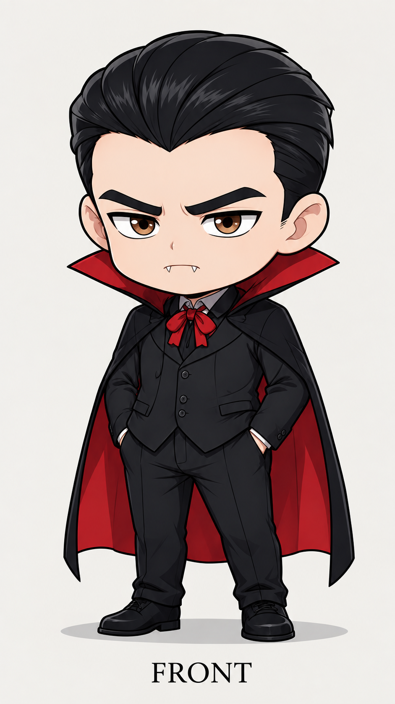
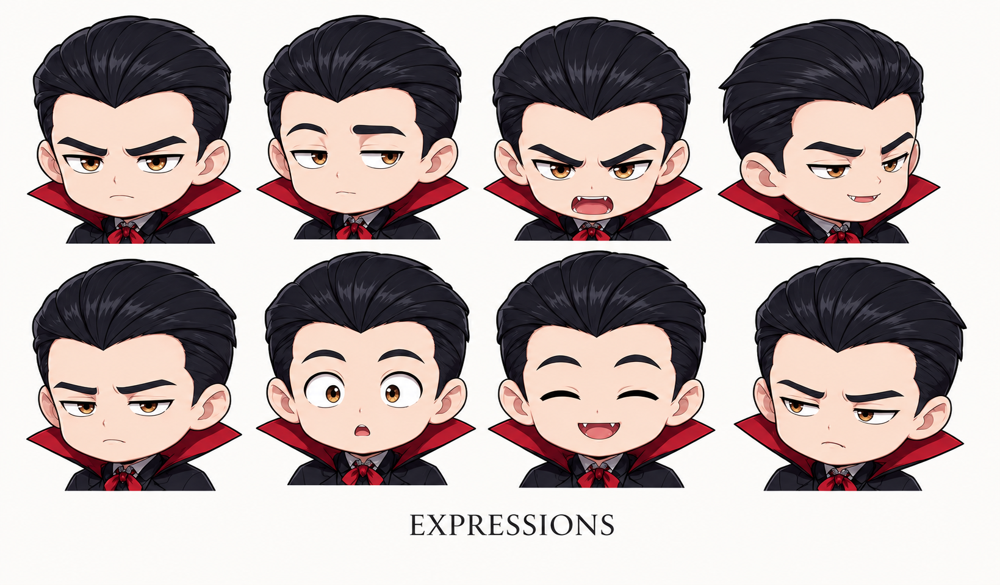
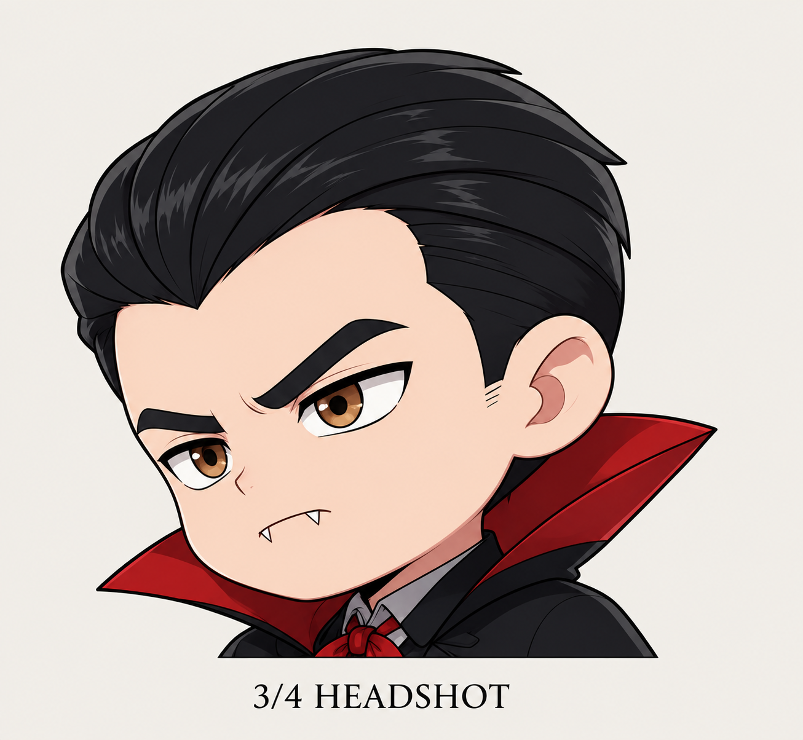

# mayda-anime-studio
AI-assisted 2D animation production pipeline with character consistency, artist-in-the-loop workflows, motion control, and selective revision.

# Mayda Anime Studio

**AI-Assisted 2D Animation Production System**

Mayda Anime Studio is an independent R&D project exploring AI-assisted animation production while preserving character identity, artistic direction, and controllable production workflows.

## What We're Building

A production pipeline that combines AI-assisted generation, character-consistent artwork, pose and motion control, localized revision, and visual quality assurance.

## Technical Approach

The system explores SDXL/LoRA-based character conditioning, reference-guided image workflows, masked inpainting, frame-level validation, and source-preserving selective repair.

## Current Status

**Active R&D / Production Prototype**

Working components and controlled experiments have been demonstrated. Full cinematic production consistency and commercial-scale validation remain in development.

## Demo & Visual Results

Selected work-in-progress previews and technical demonstrations will be shared here.

## Source Code

The core production pipeline and internal tooling are proprietary and are not publicly distributed.

## Developed by

**Mayda Studios**

### Dracula — Character Design

| Front View | Expressions | 3/4 Headshot |
|---|---|---|
|  |  |  |

Canonical character reference artwork used in
Mayda Anime Studio's animation R&D workflow.
